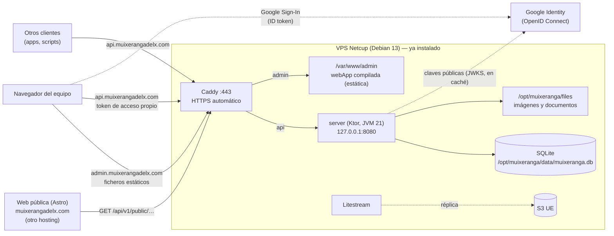
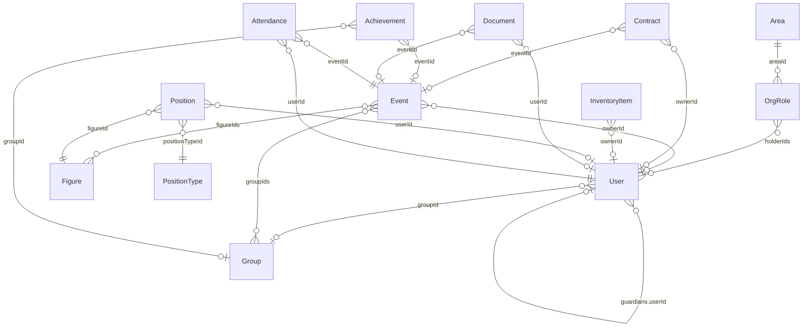

# Especificación técnica — Eina de gestió de la Muixeranga d'Elx

> **Para quien implementa (persona o IA):** este documento es la fuente de verdad del proyecto. Describe qué hay que construir, con qué tecnología y cómo se comprueba que está bien hecho. Cuando algo no esté especificado, elige la opción más simple que cumpla los requisitos y anótala en `docs/decisiones.md` del repositorio. Las palabras **DEBE**, **DEBERÍA** y **PUEDE** indican, respectivamente, obligatorio, recomendado y opcional.

| | |
|---|---|
| Versión | 1.3 (24/11/2026): alineación con repo Tabala (SQLDelight, módulos `:core`…); junta puede editar figuras; clarificaciones API/RGPD/deploy |
| Modelo de datos | v0.2 (este documento sustituye a `backend/data-model/data-model.json` v0.1 donde haya diferencias) |
| Idioma del código | Inglés (nombres de clases, campos, endpoints, valores de enumerados) |
| Idioma de la interfaz | Valenciano (textos de la webapp y etiquetas de enumerados) |
| Dominios | `api.muixerangadelx.com` (API) · `admin.muixerangadelx.com` (webapp de gestión) |

---

## Índice

1. [Contexto y objetivos](#1-contexto-y-objetivos)
2. [Arquitectura](#2-arquitectura)
3. [Estructura del repositorio KMP](#3-estructura-del-repositorio-kmp)
4. [Autenticación, roles y permisos](#4-autenticación-roles-y-permisos)
5. [Modelo de datos v0.2](#5-modelo-de-datos-v02)
6. [API REST](#6-api-rest)
7. [Webapp de gestión (admin.muixerangadelx.com)](#7-webapp-de-gestión-adminmuixerangadelxcom)
8. [Requisitos no funcionales](#8-requisitos-no-funcionales)
9. [Configuración, compilación y despliegue](#9-configuración-compilación-y-despliegue)
10. [Pruebas y criterios de aceptación](#10-pruebas-y-criterios-de-aceptación)
11. [Fases de entrega](#11-fases-de-entrega)
12. [Anexos](#12-anexos)

---

## 1. Contexto y objetivos

La **Muixeranga d'Elx** es una asociación cultural de Elx (unas 50 personas) que hace figuras humanas tradicionales valencianas. Hasta ahora se coordina con una herramienta provisional (una página web con datos en el navegador). Este proyecto la sustituye por un sistema propio:

1. **Un backend** que guarda todos los datos de la colla y los expone como **API REST JSON**.
2. **Una webapp de gestión** en `https://admin.muixerangadelx.com` para la directiva, las áreas y el equipo técnico.
3. **Una API pública** para la web de la colla (`muixerangadelx.com`, hecha con Astro y alojada en otro hosting) y para **otros clientes** futuros (apps Android/iOS, scripts, integraciones).

### 1.1 Objetivos

- **O1.** Sustituir la herramienta provisional con las mismas cinco secciones y algunas más:

  | Código | Sección | Propósito |
  |---|---|---|
  | SPEC-01 | Organigrama | Estructura de la colla (junta y áreas) y quién ocupa cada cargo. |
  | SPEC-02 | Contractacions | Actuaciones contratadas, subvenciones y catálogo de la Diputació, del primer contacto al cobro. |
  | SPEC-03 | Calendari | Ensayos, actuaciones, talleres, diades y plazos; exportación JSON e iCalendar. |
  | SPEC-04 | Inventari | Merchandising, indumentaria y material de la colla. |
  | SPEC-05 | Membres | Personas de la colla, sus datos, consentimientos y cargos. |
  | SPEC-06 | Figures | Repertorio de figuras y posiciones de cada persona (**entrega 3**, §11). |
  | SPEC-07 | Assistència | Confirmación de asistencia a ensayos y actuaciones (**entrega 3**). |
  | SPEC-08 | Documents | Actas, facturas, seguros, consentimientos firmados (**entrega 3**). |

- **O2.** Que cualquier cliente pueda usar la misma API: la webapp no tiene ningún privilegio especial.
- **O3.** Proteger los datos personales (RGPD): nada personal sale en la API pública sin consentimiento, y los menores nunca.
- **O4.** Funcionar en un VPS pequeño (2 vCPU, 2 GB RAM) con coste mínimo.
- **O5.** Todos los datos, incluidas las cuentas, los roles y las sesiones, viven en nuestra base de datos. Para entrar se usa **Google Sign-In**: Google solo confirma quién es la persona; no guarda nada de la colla y el backend no guarda contraseñas.

### 1.2 Fuera de alcance (versión 1)

Notificaciones (correo, push, WhatsApp), acceso con contraseña propia o con otros proveedores, pagos, historial de cambios/auditoría, alineaciones por actuación y plan automático con IA (propuesta 4 de la directiva), directorio de asociaciones (propuesta 7), cuotas de socios, apps móviles. El diseño **DEBE** permitir añadirlos después sin romper la API (ver §11).

---

## 2. Arquitectura



| Pieza | Tecnología | Notas |
|---|---|---|
| Backend | **Ktor 3.x** sobre JVM 21 | Un único proceso. Escucha solo en `127.0.0.1:8080`. |
| Base de datos | **SQLite** (modo WAL) | Fichero único. Migraciones con **Flyway** (SQL generado desde SQLDelight `.sqm` en el repo Tabala). Consultas con **SQLDelight**. |
| Ficheros | Disco local (`FILES_DIR`) | Servidos por el backend, con control de acceso. |
| Autenticación | **Google Sign-In** (OpenID Connect) + sesiones propias | Google confirma la identidad; el backend verifica el *ID token* de Google, busca la cuenta invitada en SQLite y emite sus propios tokens (acceso de corta duración + renovación). Sin contraseñas ni Firebase. Ver §4. |
| Webapp | **Compose Multiplatform for Web** (target `wasmJs`) | Se compila a ficheros estáticos que sirve Caddy. Consume la API como cualquier cliente. |
| Código compartido | Módulo KMP `:core` (en la spec genérica `shared/`) | Modelos `@Serializable`, enumerados, validaciones y cliente de la API (`MuixerangaApi`, Ktor Client). |
| Proxy y HTTPS | **Caddy** | Ya configurado en el servidor (ver §9.4). |

**Principio clave:** la webapp es un cliente más de la API. Toda la lógica de negocio, validación y permisos vive en el backend. Un cliente que no sea la webapp (por ejemplo una app Android hecha con el mismo módulo `shared`) **DEBE** poder hacer exactamente lo mismo con el mismo token.

---

## 3. Estructura del repositorio KMP

### 3.0 Implementación en el repositorio Tabala

El código vive en el monorepo **Tabala** (`com.bitdesal.tabala`). La spec describe una estructura genérica; este mapeo es normativo para ese repo (detalle en `docs/decisiones.md`):

| Spec (genérico) | Tabala |
|---|---|
| `shared/` (DTOs, validación, cliente API) | `:core` |
| Pantallas Compose, ViewModels, Koin | `:app:shared` |
| `webApp/` wasmJs + `index.html` | `:app:webApp` |
| `server/` | `:server` |
| Android / iOS / desktop | `:app:androidApp`, `:app:desktopApp` — **fuera de la v1** (cáscaras sin producto) |

- Persistencia servidor: **SQLDelight + Flyway**, no Exposed.
- Inyección de dependencias: **Koin** (obligatorio en Tabala).
- Navegación web: URLs reales; **Navigation 2** (no Navigation 3 salvo decisión explícita).
- Esquema SQLite v0.2: sustituye el V1 del andamiaje 0.1 si la base no tiene datos reales en producción.

Un único repositorio Gradle (Kotlin DSL, *version catalog* en `gradle/libs.versions.toml`):

```
muixeranga/
├── settings.gradle.kts
├── gradle/libs.versions.toml
├── shared/                 # KMP: jvm, wasmJs (y android/ios preparados para más adelante)
│   └── src/
│       ├── commonMain/kotlin/org/muixerangaelx/shared/
│       │   ├── model/      # DTOs @Serializable (§5), enumerados con @SerialName
│       │   ├── validation/ # reglas de validación compartidas (cliente y servidor)
│       │   ├── api/        # MuixerangaApi: cliente Ktor de todos los endpoints (§6)
│       │   └── i18n/       # etiquetas en valenciano de los enumerados
│       └── commonTest/
├── server/                 # JVM: Ktor
│   └── src/
│       ├── main/kotlin/org/muixerangaelx/server/
│       │   ├── Application.kt
│       │   ├── config/     # lectura de variables de entorno (§9.1)
│       │   ├── auth/       # verificación del ID token de Google, sesiones, permisos
│       │   ├── db/         # SQLDelight, repositorios, transacciones
│       │   ├── files/      # almacenamiento de ficheros
│       │   ├── routes/     # un fichero por recurso (§6)
│       │   └── mapping/    # entidad → DTO según audiencia (público, miembro, staff, junta)
│       ├── main/resources/
│       │   ├── db/migration/   # V1__init.sql, V2__seed.sql… (Flyway)
│       │   ├── openapi/openapi.yaml
│       │   └── logback.xml
│       └── test/kotlin/…   # tests de API y matriz de permisos (§10)
├── webApp/                 # Compose Multiplatform (wasmJs)
│   └── src/wasmJsMain/
│       ├── kotlin/…        # pantallas (§7), navegación, estado
│       └── resources/      # index.html, logo, fuentes Roboto
├── scripts/
│   ├── deploy-server.sh
│   └── deploy-web.sh
├── docs/
│   ├── decisiones.md
│   └── api.md              # guía rápida para otros clientes
└── .github/workflows/
    ├── ci.yml              # tests en cada push / PR
    ├── deploy-server.yml
    └── deploy-web.yml
```

- Paquete base en la spec genérica: `org.muixerangaelx`. En **Tabala**: `com.bitdesal.tabala`.
- **DEBE** usar versiones estables actuales: Kotlin 2.x, Ktor 3.x, Compose Multiplatform estable con soporte `wasmJs`, kotlinx.serialization, kotlinx-datetime, SQLDelight, Flyway, `org.xerial:sqlite-jdbc`, Logback.
- Autenticación: plugin `Authentication` de Ktor con `auth-jwt` (tokens propios) y `com.auth0:jwks-rsa` + `java-jwt` (ya incluidos por `auth-jwt`) para verificar el *ID token* de Google con sus claves públicas. **PUEDE** usarse en su lugar `GoogleIdTokenVerifier` de `google-api-client`.
- **DEBE** usar **Koin** para inyección de dependencias en el monorepo Tabala. En otros repos que sigan esta spec sin Tabala, **PUEDE** usarse Koin.
- **NO DEBE** usar Firebase. El único servicio externo de identidad es Google (OpenID Connect).
- El módulo `server` **DEBE** usar los mismos DTOs de `shared` para entrada y salida. No se duplican modelos.

---

## 4. Autenticación, roles y permisos

### 4.1 Autenticación con Google Sign-In

Se entra **solo con una cuenta de Google** y **solo por invitación**. Google confirma la identidad; quién puede entrar, con qué rol y durante cuánto tiempo lo decide nuestro backend con nuestra base de datos. El backend **no guarda contraseñas**.

> Una cuenta de Google no exige Gmail: quien no tenga una puede crearla con su correo de siempre en `accounts.google.com/signup` («Usar mi dirección de correo actual»).

#### Flujo

1. El cliente obtiene un **ID token** de Google (un JWT firmado por Google):
   - **Webapp:** con la librería *Google Identity Services* (`https://accounts.google.com/gsi/client`), botón «Inicia la sessió amb Google» (`google.accounts.id.renderButton`) y, opcionalmente, *One Tap*.
   - **Android:** Credential Manager con `GetGoogleIdOption` (o `GetSignInWithGoogleOption`), usando como `serverClientId` el ID de cliente **web**.
   - **iOS:** SDK *GoogleSignIn*.
2. El cliente envía el ID token a `POST /auth/google` (§6.6).
3. El backend **DEBE** verificar el ID token localmente:
   - firma RS256 con las claves públicas de Google (`https://www.googleapis.com/oauth2/v3/certs`), en caché según su `Cache-Control`;
   - `iss` = `accounts.google.com` o `https://accounts.google.com`;
   - `aud` = uno de los IDs de cliente de `GOOGLE_CLIENT_IDS`;
   - `exp` en el futuro e `iat` en el pasado (margen 60 s);
   - `email_verified = true`;
   - si el cliente envió un `nonce`, que coincida.
4. **Solo por invitación.** Con el token verificado, el backend busca la cuenta:
   1. por `googleSub` (el `sub` de Google, identificador estable de la persona); si no existe,
   2. por `account.loginEmail` = `email` del token (en minúsculas) con `status = invited` y sin `googleSub` → guarda `googleSub`, pone `status = active` (primer acceso).
   3. Si no encuentra ninguna → **403** `not_invited`. Si `status = disabled` → **403** `account_disabled`.
   4. Si encuentra la cuenta por `googleSub` pero el correo de Google ha cambiado, **no** cambia `loginEmail` (solo lo hace un `admin`).
5. El backend crea una **sesión propia** y responde con nuestros tokens. Desde aquí, el token de Google ya no se usa.
6. Actualiza `account.lastLoginAt`.

El backend **NO DEBE** guardar el ID token de Google ni pedir permisos (*scopes*) de Google más allá de `openid email profile`. No accede a Gmail, Drive ni a ningún otro dato de Google.

#### Sesiones propias

| Token | Formato | Duración | Dónde vive |
|---|---|---|---|
| **Acceso** | JWT firmado HS256 con `JWT_SECRET` (`iss = https://api.muixerangadelx.com`, `sub = userId`, `role`, `sid` = id de sesión, `exp`, `iat`) | **15 minutos** | En memoria del cliente. Se envía como `Authorization: Bearer <token>`. |
| **Renovación** | Cadena aleatoria de 32 bytes (base64url), opaca | **30 días**, deslizante | En la base de datos solo su hash SHA-256. Navegador: cookie. Otros clientes: almacenamiento seguro del dispositivo. |

- **Rotación:** cada uso de `POST /auth/refresh` invalida el token de renovación usado y entrega uno nuevo de la misma sesión. Si alguien presenta un token **ya usado**, se revoca la sesión entera (posible robo) y se responde 401.
- **Navegador (webapp):** el token de renovación va en una cookie `mux_refresh` con `HttpOnly; Secure; SameSite=Strict; Path=/api/v1/auth`. En producción, `Domain` = `COOKIE_DOMAIN` (`api.muixerangadelx.com`). En **desarrollo local** (origen distinto del API), la cookie **no** lleva `Domain` (host-only, p. ej. `localhost`). El token de acceso se guarda **solo en memoria** (nunca en `localStorage`). Al recargar la página, la webapp llama a `/auth/refresh` para recuperar la sesión sin volver a pasar por Google. El cliente **DEBE** serializar las llamadas a `/auth/refresh` (una en vuelo; el resto espera) para evitar rotación concurrente entre pestañas.
- **Otros clientes** (apps, scripts): envían `"client": "native"` y reciben el token de renovación en el cuerpo de la respuesta.
- **Comprobación en cada petición:** firma, `iss`, `exp` (margen 30 s) y, además, que la sesión `sid` no esté revocada y que la cuenta siga `active` (consulta a SQLite, con caché de 30 s como máximo). Desactivar una cuenta o cerrar una sesión tiene efecto casi inmediato.
- `JWT_SECRET`: al menos 32 bytes aleatorios, solo en el servidor. Cambiarlo cierra todas las sesiones. **DEBERÍA** admitir `JWT_SECRET_PREVIOUS` para rotarlo sin echar a nadie.

#### Protección

- **Límite de peticiones** en `/auth/google` y `/auth/refresh` (§6.10).
- **CSRF:** `/auth/google`, `/auth/refresh` y `/auth/logout` **DEBEN** comprobar que la cabecera `Origin`, si viene, está en `CORS_ORIGINS`. La cookie es `SameSite=Strict`. `admin.` y `api.` son sitios distintos; el refresco cross-site solo funciona si CORS permite el origen de `admin` con **credenciales** (`Access-Control-Allow-Credentials: true`; nunca `Access-Control-Allow-Origin: *` con cookie).
- **XSS:** el token de acceso vive en memoria, así que la webapp **DEBE** servirse con una CSP estricta (§9.4), que solo abre lo imprescindible para Google.
- **Cierre de sesión en Google:** cerrar sesión en la webapp cierra nuestra sesión y llama a `google.accounts.id.disableAutoSelect()`, para que *One Tap* no vuelva a entrar solo.

#### Invitaciones

1. Un `admin` crea la cuenta de una persona (`POST /users/{id}/account` con `loginEmail` = el correo de su cuenta de Google, y `role`). Estado: `invited`.
2. Se le avisa por el canal habitual (WhatsApp, en persona…) de que ya puede entrar en `https://admin.muixerangadelx.com` con Google. **No hay enlaces ni códigos**: basta con que el correo coincida.
3. En su primer acceso se enlaza su `googleSub` y la cuenta pasa a `active`.
4. Si la persona quiere usar otra cuenta de Google, un `admin` cambia `loginEmail` y pulsa «Desvincula Google» (`DELETE /users/{id}/account/google`): se borra `googleSub`, se cierran sus sesiones y la cuenta vuelve a `invited`.

#### Primera administradora

Al arrancar, si no existe ninguna cuenta `admin` y está definida `BOOTSTRAP_ADMIN_EMAIL`, el backend crea un `User` mínimo (`name` = parte local del correo o «Administració», sin datos sensibles) con cuenta `admin` y estado `invited`. Basta con entrar con Google usando ese correo. Después se quita la variable del fichero de entorno.

#### Cuentas

- Estados: `invited` (aún no ha entrado nunca), `active`, `disabled` (no puede entrar; sus sesiones se revocan al desactivarla).
- Cada persona puede ver sus sesiones abiertas (dispositivo y última actividad) y cerrarlas.

### 4.2 Roles de cuenta

| Rol (`account.role`) | Etiqueta | Puede |
|---|---|---|
| `member` | Membre | Leer calendario, organigrama, figuras y grupos; ver y editar su propia ficha (campos de §5.4); confirmar su asistencia. |
| `technical` | Equip tècnic | Lo de `member` + gestionar figuras, posiciones, tipos de posición, eventos, logros y asistencia; ver fichas de miembros (nivel *staff*). |
| `board` | Junta | Lo de `member` + gestionar miembros, organigrama, eventos, contrataciones, inventario, documentos, grupos, logros, **figuras y posiciones** (no los tipos de posición; eso es `technical`/`admin`). |
| `admin` | Administració | Todo, incluidas las cuentas de acceso y los roles. |

Los **cargos del organigrama** (§5.5) son información, no permisos: ocupar el cargo «Contractacions» no da acceso a las contrataciones. El acceso lo da `account.role`. (Fase futura: permisos por cargo.)

### 4.3 Niveles de visibilidad de los campos

Cada campo del modelo tiene un nivel. El backend **DEBE** construir la respuesta según el nivel del que pregunta, con DTOs distintos (no basta con ocultar campos en la webapp):

| Nivel | Quién lo ve |
|---|---|
| `public` | Cualquiera, en la API pública (`/api/v1/public/…`). Para personas: solo si `consent.publicProfile = true`, `status = active` y no es menor. |
| `members` | Cualquier usuario con sesión. |
| `staff` | Roles `technical`, `board`, `admin`. |
| `board` | Roles `board`, `admin`. |
| `self` | La propia persona + `board` + `admin`. |
| `server` | Nunca sale del backend. |

### 4.4 Matriz de permisos por recurso

L = leer · C = crear · U = modificar · D = borrar/archivar · «propio» = solo su registro.

| Recurso | Público | member | technical | board | admin |
|---|---|---|---|---|---|
| `users` | Ficha pública filtrada | L/U propio | L (staff) / U propio | L C U D | L C U D |
| `users/{id}/account` | — | — | — | — | L C U D |
| `areas`, `org-roles` | Organigrama filtrado | L | L | L C U D | L C U D |
| `events` | Publicados, campos públicos | L | L C U D | L C U D | L C U D |
| `attendance` | — | L/U propio | L C U | L C U | L C U |
| `contracts` | — | — | — | L C U D | L C U D |
| `inventory-items` | — | — | — | L C U D | L C U D |
| `groups` | L | L | L | L C U D | L C U D |
| `achievements` | L | L | L C U D | L C U D | L C U D |
| `figures`, `positions` | L (personas filtradas) | L | L C U D | L C U D | L C U D |
| `position-types` | L | L | L C U D | L | L C U D |
| `documents` | — | — | — | L C U D | L C U D |

### 4.5 Tablas de autenticación

Además de `account` dentro de `User` (§5.4), el backend usa estas tablas internas, que **nunca** se exponen tal cual en la API:

| Tabla | Campos |
|---|---|
| `google_identities` | `userId` (PK), `googleSub` (único), `linkedAt` |
| `sessions` | `id`, `userId`, `createdAt`, `lastUsedAt`, `expiresAt`, `revokedAt`, `clientType` (`web`/`native`), `userAgent` (máx. 200) |
| `refresh_tokens` | `id`, `sessionId`, `tokenHash` (SHA-256, único), `createdAt`, `usedAt` |

No se guardan direcciones IP ni el ID token de Google. Al arrancar y, como mínimo, una vez cada 24 h, el backend borra sesiones caducadas o revocadas hace más de 30 días (tarea en el mismo proceso Ktor, sin cron externo).

### 4.6 Configuración en Google Cloud

Se hace una vez, con una cuenta de Google de la colla (no personal), en `console.cloud.google.com`. **No es Firebase** y no tiene coste.

1. Crear un proyecto, p. ej. `muixeranga-elx`.
2. **Google Auth Platform → Branding** (pantalla de consentimiento): tipo *Externo*; nombre «Muixeranga d'Elx»; correo de asistencia y de contacto de la colla; dominio autorizado `muixerangadelx.com`; enlaces a la política de privacidad y a la página principal de la web. Sin logo al principio (subirlo obliga a una verificación de marca).
3. **Data access:** solo los permisos `openid`, `email` y `profile` (no sensibles: no necesitan verificación de Google).
4. **Audience:** publicar la aplicación (*In production*). En modo *Testing* solo pueden entrar las cuentas de prueba que se apunten a mano.
5. **Clients → Create client → Web application** «Gestió Muixeranga (web)»: orígenes de JavaScript autorizados `https://admin.muixerangadelx.com` y, para desarrollo, `http://localhost:8080` y `http://localhost`. No hacen falta URIs de redirección. El **ID de cliente** es público; el *client secret* **no se usa**.
6. Más adelante, para apps: un cliente *Android* (nombre del paquete + huella SHA-1) y uno *iOS* (bundle ID), y añadir el de iOS a `GOOGLE_CLIENT_IDS`.

### 4.7 Ampliación futura

- **Tokens de API personales** para scripts y automatizaciones (creados por un `admin`, con caducidad y rol limitado), para no tener que obtener un ID token de Google desde un script.
- Otros proveedores (Apple, Microsoft) con el mismo esquema: verificar su ID token y enlazarlo a la cuenta invitada.

---

## 5. Modelo de datos v0.2

### 5.1 Convenciones

- **Identificadores:** UUID (v7 recomendado) como `string`. Las referencias son `xxxId` (un ID) o `xxxIds` (lista de IDs).
- **Campos comunes** en todos los modelos: `id`, `createdAt`, `updatedAt` (solo lectura) y `version` (entero, para concurrencia optimista: ver §6.5).
- **Tipos:**

  | Tipo | Formato JSON | Ejemplo |
  |---|---|---|
  | `datetime` | ISO 8601 en UTC | `"2026-08-15T18:00:00Z"` |
  | `date` | `YYYY-MM-DD` | `"1990-04-12"` |
  | `year` | entero | `2024` |
  | `money` | número con 2 decimales, en euros (en BD: entero en céntimos) | `450.00` |
  | `email` | texto en minúsculas | `"toni@example.org"` |
  | `phone` | E.164 | `"+34600000000"` |
  | `geopoint` | objeto | `{"latitude": 38.2669, "longitude": -0.6984}` |
  | `file` | objeto `FileRef` | `{"id": "…", "url": "https://api…/files/…", "thumbUrl": "…" (opcional), "contentType": "image/webp", "size": 12345}` |
  | `enum` | texto en `snake_case` | `"to_contact"` |

- **Zona horaria:** se guarda en UTC; la webapp muestra siempre `Europe/Madrid`. Un evento `allDay` guarda la medianoche de Madrid de ese día.
- **Campos calculados** (*derived*): no se guardan; el backend los calcula al responder. Ninguna relación se guarda en los dos lados.
- **Archivar en lugar de borrar:** `User` (estado `former`), `Contract` e `InventoryItem` (`archived = true`). `DELETE` en estos recursos archiva; el borrado físico solo lo hace `admin` con `?hard=true`.
- **Textos libres** en valenciano. **Límites de longitud** indicados como `máx. N`.

### 5.2 Cambios respecto a v0.1

1. **Organigrama nuevo (16/11/2026).** Las 16 áreas de 2025 se sustituyen por la **Junta directiva + 7 áreas** con **40 cargos** (§5.5, datos iniciales en §12.1). Por eso:
   - se añade el modelo **`OrgRole`** (cargo), que pertenece a un `Area` y tiene sus titulares (`holderIds`);
   - `Area` pierde `leadIds`, `memberIds`, `goals` y `meetingFrequency`, y gana `kind` (`board` / `area`);
   - `User` pierde `boardRole` y `boardRoleSince`; sus cargos se calculan (`User.orgRoles`).
2. **Concurrencia optimista:** nuevo campo común `version`.
3. **Ficheros:** todos los campos de fichero devuelven un objeto `FileRef` y se suben por endpoints propios (§6.9).

### 5.3 Enumerados

| Enumerado | Valores |
|---|---|
| `AccountRole` | `member`, `technical`, `board`, `admin` |
| `AccountStatus` | `invited`, `active`, `disabled` |
| `MemberStatus` | `active`, `inactive`, `on_leave`, `former` |
| `MembershipType` | `member`, `collaborator`, `honorary` |
| `Relationship` | `mother`, `father`, `legal_guardian`, `partner`, `sibling`, `grandparent`, `friend`, `other` |
| `ShirtSize` | `xs`, `s`, `m`, `l`, `xl`, `xxl`, `xxxl`, `kids_4`, `kids_6`, `kids_8`, `kids_10`, `kids_12`, `kids_14` |
| `AreaKind` | `board`, `area` |
| `AreaStatus` | `active`, `developing`, `inactive` |
| `EventType` | `assaig`, `actuacio`, `altre` |
| `EventCategory` | `actuacio`, `taller`, `diada`, `trobada`, `assaig`, `reunio`, `termini`, `altre` |
| `EventStatus` | `planned`, `confirmed`, `done`, `cancelled` |
| `DressCode` | `full`, `shirt`, `casual`, `none` |
| `ContractType` | `dipu_catalog`, `grant`, `direct`, `exchange`, `neighbourhood_party`, `other` |
| `ContractStatus` | `to_contact`, `contacted`, `proposal_sent`, `negotiating`, `confirmed`, `done`, `invoiced`, `paid`, `discarded` |
| `PaymentMethod` | `transfer`, `cash`, `bizum`, `other` |
| `InventoryCategory` | `merch`, `clothing`, `technical`, `other` |
| `ItemCondition` | `new`, `good`, `worn`, `broken`, `lost` |
| `FigureStatus` | `learning`, `consolidated`, `retired` |
| `DocumentKind` | `minutes`, `invoice`, `contract`, `grant`, `statutes`, `insurance`, `consent`, `other` |
| `AttendanceStatus` | `yes`, `no`, `maybe`, `attended`, `absent` |

Las etiquetas en valenciano de todos los valores están en §12.3 y **DEBEN** vivir en `shared/i18n`.

### 5.4 User (persona de la colla)

Todas las personas de la colla, tengan cuenta o no (la xicalla normalmente no tiene). Lectura: `staff` + la propia persona. Escritura: `board`, `admin`.

| Campo | Tipo | Oblig. | Visibilidad | Notas |
|---|---|---|---|---|
| `name` | string máx. 80 | sí | public | |
| `lastNames` | string máx. 120 | | public | |
| `nickname` | string máx. 60 | | public | Malnom. |
| `birthDate` | date | | board | Para calcular `isMinor`. |
| `isMinor` | boolean | calc. | staff | Menor de 18 años según `birthDate`. Si no hay fecha: `false`. |
| `documentId` | string máx. 20 | | board | DNI/NIE. Opcional. |
| `email` | email | | self | Contacto. |
| `phoneNumber` | phone | | self | |
| `address` | objeto `{street, postalCode, city, province}` | | self | |
| `aboutMe` | text máx. 2000 | | public | |
| `avatar` | file (jpeg/png/webp, máx. 5 MB) | | public | |
| `status` | MemberStatus | sí | staff | Por defecto `active`. |
| `membershipType` | MembershipType | | staff | |
| `memberNumber` | integer, único | | board | Número de socio. |
| `joinedAt` | date | | staff | |
| `leftAt` | date | | board | |
| `heightCm` | integer 50–250 | | staff | Para colocar en figuras. |
| `sizes` | objeto `{shirt: ShirtSize, trousers: string}` | | self | Tallas. |
| `emergencyContact` | objeto `{name, relationship: Relationship, phone}` | | staff | |
| `guardians` | lista de `{name, relationship, phone, email, userId?}` | si `isMinor` | board | Tutores legales. `userId` si el tutor es también miembro. |
| `consent` | objeto (ver abajo) | | self | RGPD. |
| `account` | objeto o `null` (ver abajo) | | self | `null` = sin acceso a la app. |
| `notes` | text | | `self` en `/me` y export propio; `board` y `admin` en ficha de junta | Notas sobre la persona. La persona **puede** verlas en su perfil y en `GET /me/export`. El resto de roles no las ven en fichas ajenas salvo `board`/`admin`. |
| `groupId` | ref Group | | members | Por defecto, la colla propia. |
| `orgRoles` | lista `{orgRoleId, name, areaId, areaName}` | calc. | members | Cargos que ocupa (desde `OrgRole.holderIds`). |
| `positions` | lista `{positionId, figureId, positionTypeId}` | calc. | staff | Sus posiciones en figuras (fase 2). |

`consent`: `dataProcessing` (bool, acepta la política de privacidad), `publicProfile` (bool, puede salir en la web), `imageRights` (bool), `whatsapp` (bool), `signedAt` (datetime), `signedBy` (string, quién firmó: la persona o su tutor). Todos `false` por defecto.

`account`: `role` (AccountRole), `loginEmail` (email, único: el correo de su cuenta de Google), `status` (AccountStatus), `invitedAt` (datetime), `lastLoginAt` (datetime, solo lectura), `googleLinked` (boolean, calculado: ya ha entrado alguna vez). El `googleSub` y las sesiones viven en tablas aparte (§4.5) y **nunca** salen en las respuestas. Solo `admin` modifica `account`.

**Campos que la propia persona puede modificar** (`PATCH /me`): `nickname`, `phoneNumber`, `aboutMe`, `address`, `emergencyContact`, `sizes`, `consent.dataProcessing` (solo a `true` en el setup inicial), `consent.publicProfile`, `consent.imageRights`, `consent.whatsapp`, `consent.signedAt`, `consent.signedBy`, y su `avatar`. Cualquier otro campo en esa petición → **403** `field_not_editable`.

Reglas:
- Si `isMinor = true`, `guardians` **DEBE** tener al menos un elemento (validación al guardar, 422 si falta). Para menores, `consent` lo firma un tutor.
- Un menor **NUNCA** aparece en la API pública, aunque tenga `consent.publicProfile = true`.
- Si un menor tiene cuenta de la app: usa `GET /me` y `PATCH /me` con los campos permitidos a menores; la ficha completa (tutores, datos de junta) la gestionan solo **`board`** y **`admin`** en `/users/{id}`. Los tutores que sean `member` **no** obtienen acceso extra a la ficha del menor.
- **`consent.dataProcessing`:** en el **primer acceso** tras el login (cuenta pasa de `invited` a `active` o primer inicio con cuenta ya `active`), la webapp **DEBE** mostrar un paso de configuración inicial (setup) donde la persona (o su tutor si es menor) acepta la política de privacidad (`dataProcessing = true`, `signedAt`, `signedBy`). Hasta completarlo, solo están permitidas rutas de sesión (`/me`, consentimientos, cierre de sesión); el resto de la API responde **403** `consent_required` si `dataProcessing` sigue siendo `false`.

### 5.5 Area y OrgRole (organigrama, SPEC-01)

**Area** — unidad del organigrama: la Junta directiva o un área de trabajo. Lectura: `members`. Escritura: `board`, `admin`.

| Campo | Tipo | Oblig. | Visib. | Notas |
|---|---|---|---|---|
| `name` | string máx. 120 | sí | public | «Tècnica», «Màrqueting i comunicació»… |
| `slug` | string máx. 60, único | sí | public | `tecnica`, `marqueting`… |
| `kind` | AreaKind | sí | public | `board` solo para la Junta directiva (una única). |
| `description` | text | | members | |
| `status` | AreaStatus | sí | members | Por defecto `active`. |
| `order` | integer | | members | Orden en el organigrama. |
| `color` | `#RRGGBB` | | members | |
| `whatsappGroup` | string máx. 120 | | members | Nombre del grupo de WhatsApp del área. |
| `notes` | text | | board | Tareas pendientes. |
| `roles` | lista de OrgRole | calc. | members | Sus cargos, ordenados por `order`. |

**OrgRole** — cargo dentro de un área. Lectura: `members`. Escritura: `board`, `admin`.

| Campo | Tipo | Oblig. | Visib. | Notas |
|---|---|---|---|---|
| `areaId` | ref Area | sí | public | Al borrar el área: restringido (no se puede borrar un área con cargos). |
| `name` | string máx. 120 | sí | public | «Xarxes socials», «Presidència»… Único dentro del área. |
| `description` | text | | members | Qué hace este cargo. |
| `isLead` | boolean | | public | Cargo responsable del área (p. ej. «Responsable de tècnica»). |
| `order` | integer | | members | |
| `holderIds` | refArray User | | members | Personas que lo ocupan (puede haber varias o ninguna). |
| `vacant` | boolean | calc. | members | `holderIds` vacío. |

Reglas:
- Una persona puede ocupar varios cargos. Un cargo puede tener varias personas.
- Al archivar a una persona (`status = former`) se la quita de todos los `holderIds`.
- La «Assemblea de socis» no es un área: es solo el nivel superior del dibujo del organigrama.

### 5.6 Event (calendario, SPEC-03)

Lectura: `members` (y público si `published`). Escritura: `technical`, `board`, `admin`.

| Campo | Tipo | Oblig. | Visib. | Notas |
|---|---|---|---|---|
| `name` | string máx. 200 | sí | public | |
| `date` | datetime | sí | public | Inicio. |
| `endDate` | datetime | | public | ≥ `date`. |
| `allDay` | boolean | | public | |
| `type` | EventType | sí | public | Compatibilidad con Tabala. **`category` manda:** al guardar, el servidor deriva `type` — `category = assaig` → `type = assaig`; `actuacio`, `taller`, `diada`, `trobada` → `type = actuacio`; el resto → `type = altre`. El cliente puede enviar `type`; el servidor lo normaliza. |
| `category` | EventCategory | sí | public | Para colores y filtros. Si es `reunio` o `termini`, `published` se fuerza a `false`. |
| `status` | EventStatus | sí | public | Por defecto `planned`. |
| `published` | boolean | | staff | Visible en la API pública. Por defecto `false`. |
| `description` | text | | public | Descripción **pública**. |
| `image` | file | | public | |
| `gallery` | lista de file (máx. 50) | | public | |
| `link` | url | | public | |
| `location` | geopoint | | public | |
| `locationName` | string máx. 200 | | public | «Plaça del Raval, Elx». |
| `address` | string máx. 300 | | public | |
| `figureIds` | refArray Figure | | public | Figuras previstas o hechas. |
| `groupIds` | refArray Group | | public | Colles participantes. |
| `meetingTime` | datetime | | members | Hora de quedada. |
| `meetingPoint` | string máx. 200 | | members | |
| `dressCode` | DressCode | | members | |
| `ownerId` | ref User | | members | Responsable. |
| `attendanceOpen` | boolean | | members | Si los miembros pueden confirmar asistencia (fase 2). |
| `notes` | text | | staff | Notas internas (logística, permisos…). |
| `contractId` | ref Contract | calc. | board | Desde `Contract.eventId`. |
| `documentIds` | refArray Document | calc. | board | Desde `Document.eventId`. |
| `attendanceSummary` | `{yes, no, maybe, attended, absent}` | calc. | members | Fase 2. |

### 5.7 Contract (contrataciones, SPEC-02)

Lectura y escritura: `board`, `admin`.

| Campo | Tipo | Oblig. | Notas |
|---|---|---|---|
| `title` | string máx. 200 | sí | «Ajuntament de Novelda – catàleg Dipu». |
| `type` | ContractType | sí | |
| `status` | ContractStatus | sí | Por defecto `to_contact`. |
| `client` | `{name, taxId, municipality, address}` | | |
| `contact` | `{name, position, phone, email, verifiedAt: date}` | | Persona con quien se habla. |
| `amount` | money | | |
| `vatIncluded` | boolean | | |
| `performanceDate` | datetime | | Fecha de la actuación. |
| `nextAction` | string máx. 200 | | Próxima acción. |
| `nextActionAt` | date | | Si está vencida y el estado no es final → «atrasada». |
| `ownerId` | ref User | | Responsable. |
| `eventId` | ref Event, único | | Evento del calendario creado para esta contratación. |
| `grant` | `{body, call, applicationDeadline, justificationDeadline, requestedAmount, grantedAmount}` o null | | Solo si `type = grant`. |
| `billing` | `{invoiceNumber, invoicedAt, paidAt, paymentMethod}` | | |
| `discardReason` | string | si `discarded` | |
| `notes` | text | | |
| `archived` | boolean | | |
| `overdue` | boolean | calc. | `nextActionAt < hoy` y estado no final (`paid`, `discarded`). |

Reglas de estado:
- Orden normal: `to_contact → contacted → proposal_sent → negotiating → confirmed → done → invoiced → paid`. Se **PUEDE** saltar estados hacia delante o volver atrás; `discarded` es posible desde cualquiera.
- Pasar a `invoiced` exige `billing.invoicedAt`; pasar a `paid` exige `billing.paidAt` (si faltan, el servidor pone la fecha de hoy).
- **Catálogo de la Diputació:** se pueden conseguir como mucho unas **5** contrataciones `dipu_catalog` por año natural (estado `confirmed` o posterior, según `performanceDate`, o `updatedAt` si no hay fecha). El servidor **no bloquea** superar el límite: lo informa en `GET /contracts/summary` (`dipuCatalog.confirmed` / `limit`), y la webapp **DEBE** pedir confirmación al confirmar una contratación que lo supere. Límite configurable con `DIPU_CATALOG_LIMIT` (por defecto 5).
- Acción «crear evento» (§6.7): crea un `Event` con los datos de la contratación y rellena `eventId`.

### 5.8 InventoryItem (inventario, SPEC-04)

Lectura y escritura: `board`, `admin`.

| Campo | Tipo | Oblig. | Notas |
|---|---|---|---|
| `name` | string máx. 200 | sí | |
| `category` | InventoryCategory | sí | |
| `description` | text | | |
| `image` | file | | |
| `variants` | lista `{label, quantity ≥ 0, minStock ≥ 0}` | sí (≥1) | Una por talla o color. Sin variantes → una sola con `label = "única"`. `label` único dentro del artículo. |
| `totalQuantity` | integer | calc. | Suma de `variants[].quantity`. |
| `lowStock` | boolean | calc. | Alguna variante con `quantity ≤ minStock`. |
| `forSale` | boolean | | |
| `salePrice`, `memberPrice`, `unitCost` | money | | |
| `supplier` | string | | |
| `condition` | ItemCondition | | Para material, no para merchandising. |
| `storageLocation` | string máx. 200 | | Dónde se guarda. |
| `ownerId` | ref User | | Responsable. |
| `lastCountedAt` | date | | `null` = «per comptar». |
| `notes` | text | | |
| `archived` | boolean | | |

### 5.9 Group y Achievement

**Group** (colles: la propia y las invitadas). Lectura: pública. Escritura: `board`, `admin`.

`name` (oblig.), `subtitle`, `contact`, `foundation` (year), `history` (text), `image` (file), `logo` (file), `location` (geopoint), `faixa` / `shirt` / `trousers` (listas de colores `#RRGGBB`), `isOwn` (boolean; solo un grupo puede tenerlo), `website` (url), `socialLinks` (`{instagram, facebook, x, youtube}`). Calculados: `eventIds` (eventos publicados donde participa), `achievementIds`, `memberIds` (solo en el grupo propio y solo miembros públicos).

**Achievement** (logros). Lectura: pública. Escritura: `technical`, `board`, `admin`.

`title` (oblig.), `subtitle`, `year` (oblig.), `logo` (file), `groupId` (ref Group), `eventId` (ref Event, opcional).

### 5.10 Figure, PositionType y Position (SPEC-06, fase 2)

**Figure.** Lectura: `members` y pública (personas filtradas). Escritura: `technical`, `board`, `admin`.

`name` (oblig., único), `description`, `levels` (1–8, altures), `peopleRequired`, `difficulty` (1–5), `status` (FigureStatus), `firstPerformedAt` (date), `image` (file, esquema o foto), `videoUrl` (url, visibilidad members). Calculado: `positions` (lista de Position de la figura).

**PositionType** (tipo de posición: Baix, Mans, Segon, Xicalla…), editable desde la webapp. Campos: `name` (oblig., único, máx. 60). Borrado restringido mientras alguna posición lo use (409 `in_use`). Datos iniciales en §12.2.

**Position** (un lugar de una figura). Escritura: `technical`, `board`, `admin`.

| Campo | Tipo | Oblig. | Notas |
|---|---|---|---|
| `figureId` | ref Figure | sí | Al borrar la figura se borran sus posiciones. |
| `positionTypeId` | ref PositionType | sí | |
| `userId` | ref User | | Persona en esa posición; `null` = sin asignar. Al borrar la persona → `null`. |
| `x`, `y`, `z` | integer | sí | Ver supuesto abajo. |

Restricciones: una persona como mucho una vez por figura (`figureId`+`userId` único cuando `userId` no es nulo); dos posiciones no pueden tener las mismas `x,y,z` en la misma figura.

> **Supuesto pendiente de confirmar:** `x`, `y` son casillas de una cuadrícula en el suelo con origen `(0,0)` en el centro de la figura (`x` positivo a la derecha del público, `y` positivo alejándose del público); `z` es el nivel de altura (0 = suelo/pinya, 1 = primer piso…). Rango −20…20 para `x`,`y` y 0…8 para `z`.

En la API pública, `userId` se devuelve `null` si la persona es menor o no tiene perfil público.

### 5.11 Document (SPEC-08, fase 2)

Lectura y escritura: `board`, `admin`.

`title` (oblig., máx. 200), `kind` (DocumentKind, oblig.), `date` (date), `file` (oblig.; PDF, imágenes u Office; máx. 50 MB; **protegido**), `eventId` (ref Event, opcional), `userId` (ref User, opcional; p. ej. su consentimiento firmado con `kind = consent`), `notes`.

### 5.12 Attendance (SPEC-07, fase 2)

`eventId` (oblig.), `userId` (oblig.), `status` (AttendanceStatus, oblig.), `comment` (máx. 200, visibilidad staff), `answeredAt` (solo lectura). Único por (`eventId`, `userId`).

- Un `member` solo puede poner `yes`, `no` o `maybe` en su propia asistencia, y solo si `event.attendanceOpen = true` y el evento no ha empezado.
- `attended` y `absent` los ponen `technical` o `board` después del evento.

### 5.13 Diagrama de entidades



Las relaciones `refArray` (`holderIds`, `figureIds`, `groupIds`) **DEBEN** guardarse en tablas intermedias en SQLite, con claves foráneas.

---

## 6. API REST

### 6.1 Generalidades

- **URL base:** `https://api.muixerangadelx.com/api/v1`.
- **Formato:** JSON UTF-8 (`application/json`), salvo subidas (`multipart/form-data`) y exportaciones (`text/calendar`).
- **Documentación:** el backend **DEBE** servir OpenAPI 3.1 en `GET /api/v1/openapi.yaml`. Swagger UI en `GET /api/v1/docs` solo si `ENABLE_API_DOCS=true` o el usuario tiene sesión con rol `board`/`admin` (en producción no exponer la API privada al público). La especificación **DEBE** coincidir con la implementación (un test lo comprueba, §10).
- **Versionado:** cambios incompatibles → `/api/v2`. Añadir campos o endpoints no rompe la versión: los clientes **DEBEN** ignorar campos desconocidos (`ignoreUnknownKeys = true` en el cliente de `shared`).
- **CORS:** solo los orígenes de `CORS_ORIGINS` (por defecto `https://admin.muixerangadelx.com`, `https://muixerangadelx.com`, `https://www.muixerangadelx.com`), con credenciales en rutas que usan cookie (`/auth/*`). Los endpoints `/public/*` **PUEDEN** permitir cualquier origen en `GET` **sin** credenciales.
- **Salud:** `GET /api/health` (sin versión ni autenticación) → `200 {"status":"ok","version":"1.0.0","db":"ok"}`; `503` si la base de datos no responde.

### 6.1.1 Catálogo de `permissions` (`GET /me`)

La webapp oculta secciones según esta lista (el servidor la calcula desde `account.role`). Formato: `recurso:acción` (`read`, `write`, `admin` solo en cuentas).

| Permiso | `member` | `technical` | `board` | `admin` |
|---|---|---|---|---|
| `org-chart:read` | sí | sí | sí | sí |
| `events:read` | sí | sí | sí | sí |
| `events:write` | | sí | sí | sí |
| `contracts:read` | | | sí | sí |
| `contracts:write` | | | sí | sí |
| `inventory:read` | | | sí | sí |
| `inventory:write` | | | sí | sí |
| `users:read` (staff) | | sí | sí | sí |
| `users:write` | | | sí | sí |
| `figures:read` | sí | sí | sí | sí |
| `figures:write` | | sí | sí | sí |
| `position-types:write` | | sí | | sí |
| `documents:read` | | | sí | sí |
| `documents:write` | | | sí | sí |
| `groups:read` | sí | sí | sí | sí |
| `groups:write` | | | sí | sí |
| `achievements:write` | | sí | sí | sí |
| `attendance:write` | | sí | sí | sí |
| `accounts:admin` | | | | sí |
| `config:write` | | | sí | sí |

### 6.2 Listados

- Paginación: `?page=1&perPage=50` (máx. 200). Respuesta:
  ```json
  { "items": [ … ], "page": 1, "perPage": 50, "totalItems": 134, "totalPages": 3 }
  ```
- Orden: `?sort=campo` o `?sort=-campo` (descendente). Cada recurso documenta los campos ordenables y su orden por defecto.
- Búsqueda de texto: `?q=texto` en los recursos que lo indiquen.
- Filtros: parámetros con el nombre del campo, documentados por recurso.

### 6.3 Errores

Todas las respuestas de error usan el mismo formato:

```json
{
  "error": {
    "code": "validation_failed",
    "message": "Hi ha camps amb errors.",
    "fields": { "name": "required", "endDate": "must_be_after_date" }
  }
}
```

| HTTP | `code` típicos |
|---|---|
| 400 | `bad_request`, `invalid_json`, `invalid_parameter` |
| 401 | `unauthenticated` (sin token o token inválido/caducado), `invalid_google_token` (ID token de Google no válido, caducado, de otro cliente o con correo sin verificar), `session_revoked` |
| 403 | `forbidden`, `not_invited`, `account_disabled`, `field_not_editable`, `consent_required` (falta `consent.dataProcessing` tras el login) |
| 404 | `not_found` (también cuando el recurso existe pero el usuario no puede verlo) |
| 409 | `version_conflict`, `duplicate`, `in_use`, `already_exists` |
| 413 | `file_too_large` |
| 415 | `unsupported_media_type` |
| 422 | `validation_failed` |
| 429 | `rate_limited` (con cabecera `Retry-After`) |
| 500 | `internal_error` (sin detalles internos ni trazas) |

`message` en valenciano, pensado para mostrarse al usuario. `code` estable, pensado para los clientes.

### 6.4 Validación

- La validación vive en `shared/validation` y la ejecutan **los dos lados**: la webapp para avisar antes de enviar, el servidor siempre.
- Campos **desconocidos** en el cuerpo → se **ignoran** (clientes nuevos frente a API antigua). Campos de solo lectura o calculados → se ignoran. En `PATCH /me`, un campo no editable → **403** `field_not_editable` (no 400).
- Textos: se recortan espacios; longitud máxima según §5. Correos en minúsculas. Teléfonos en E.164 (la webapp **PUEDE** aceptar `600000000` y añadir `+34`).

### 6.5 Crear, modificar y concurrencia

- `POST /recurso` → `201` con el objeto completo y cabecera `Location`.
- `PATCH /recurso/{id}` → *JSON Merge Patch* (RFC 7386): solo los campos enviados; `null` borra el valor. Respuesta `200` con el objeto completo.
- El cuerpo de `PATCH` **DEBE** incluir `version`. Si no coincide con la versión guardada → **409** `version_conflict` con el objeto actual en `error.current`. Cada escritura incrementa `version`.
- `DELETE /recurso/{id}` → `204` (o archiva, según §5.1).

### 6.6 Autenticación (sin token de acceso)

| Método y ruta | Descripción |
|---|---|
| `POST /auth/google` | `{"idToken", "client": "web"\|"native", "nonce"?, "deviceName"?}` → `200 {"accessToken", "expiresIn": 900, "user": {…nivel self}}` + cookie `mux_refresh` (web) o `"refreshToken"` en el cuerpo (native). Errores: 401 `invalid_google_token`, 403 `not_invited`, 403 `account_disabled`. |
| `POST /auth/refresh` | Web: con la cookie. Native: `{"refreshToken"}`. → nuevo `accessToken` y token de renovación rotado. |
| `POST /auth/logout` | Cierra la sesión actual y borra la cookie. |
| `GET /auth/config` | Público: `{"googleClientId"}`, para que los clientes no tengan que llevarlo compilado. |

### 6.7 Endpoints privados (requieren `Authorization: Bearer`)

Los permisos de cada uno siguen la matriz de §4.4.

**Sesión y perfil propio**

| Método y ruta | Descripción |
|---|---|
| `GET /me` | Usuario actual (nivel `self`), con `account.role` y lista `permissions` (strings estables, ver §6.1.1) para que los clientes muestren u oculten opciones. |
| `PATCH /me` | Modifica los campos propios de §5.4. |
| `PUT /me/avatar` · `DELETE /me/avatar` | Sube o quita la foto propia. |
| `GET /me/export` | Todos sus datos en JSON (derecho de acceso RGPD). |
| `GET /me/sessions` · `DELETE /me/sessions/{id}` · `POST /auth/logout-all` | Ver y cerrar sus sesiones abiertas. |

**Personas (SPEC-05)**

| Método y ruta | Descripción |
|---|---|
| `GET /users` | Filtros: `status`, `membershipType`, `isMinor`, `orgRoleId`, `areaId`, `hasAccount`; `q` busca en nombre, apellidos y malnom. Orden por defecto `name`. |
| `GET /users/{id}` | Nivel según rol. |
| `POST /users` · `PATCH /users/{id}` · `DELETE /users/{id}` | `DELETE` = `status: former` y se quita de los cargos. |
| `PUT /users/{id}/avatar` · `DELETE /users/{id}/avatar` | |
| `POST /users/{id}/account` | **admin.** Crea la cuenta: `{loginEmail, role}` → `status: invited`. La persona ya puede entrar con Google usando ese correo. |
| `DELETE /users/{id}/account/google` | **admin.** Desvincula la cuenta de Google (borra `googleSub`, cierra sus sesiones, vuelve a `invited`). |
| `PATCH /users/{id}/account` | **admin.** Cambia `role` o `status` (`disabled` quita el acceso y cierra sus sesiones). Un `admin` **no** puede quitarse el rol `admin` ni desactivarse si es el **último** `admin`. |
| `DELETE /users/{id}/account` | **admin.** Elimina la cuenta, su vínculo con Google y sus sesiones (la persona sigue en la colla). Un `admin` no puede borrar ni desactivar su propia cuenta si es el último `admin`. |
| `POST /users/{id}/anonymize` | **admin.** Derecho de supresión: borra datos personales identificables; deja `name = "Persona eliminada"`, `status = former`; quita la persona de `holderIds`, pone `userId = null` en posiciones, borra cuenta y vínculo Google, elimina tutores y ficheros de avatar asociados. Irreversible; exige `{"confirm": true}`. |

**Organigrama (SPEC-01)**

| Método y ruta | Descripción |
|---|---|
| `GET /org-chart` | Organigrama completo en una llamada: lista de áreas (Junta primero, luego por `order`) con sus cargos y titulares (`{id, name, lastNames, nickname, avatar}`). Incluye menores con cuenta (herramienta **interna**); la API pública sigue filtrando menores (§6.8). |
| `GET /areas` · `GET /areas/{id}` · `POST /areas` · `PATCH /areas/{id}` · `DELETE /areas/{id}` | `DELETE` falla con 409 `in_use` si tiene cargos. |
| `GET /org-roles?areaId=` · `GET /org-roles/{id}` · `POST /org-roles` · `PATCH /org-roles/{id}` · `DELETE /org-roles/{id}` | |
| `PUT /org-roles/{id}/holders` | Sustituye los titulares: `{"holderIds": ["…"], "version": 3}`. |

**Calendario (SPEC-03)**

| Método y ruta | Descripción |
|---|---|
| `GET /events` | Filtros: `from`, `to` (fechas `YYYY-MM-DD` en hora de Madrid, incluidas), `category` (admite varias separadas por comas), `status`, `published`, `ownerId`. Orden por defecto `date`. |
| `GET /events/{id}` · `POST /events` · `PATCH /events/{id}` · `DELETE /events/{id}` | |
| `PUT /events/{id}/image` · `DELETE /events/{id}/image` | |
| `POST /events/{id}/gallery` · `DELETE /events/{id}/gallery/{fileId}` | Varias imágenes por petición. |
| `GET /events/export?from=&to=&format=json\|ics` | Exportación con nivel `members`. `json` = el mismo formato que `GET /public/events` (§6.8) con los campos de nivel members; `ics` = iCalendar. |

**Asistencia (SPEC-07, fase 2)**

| Método y ruta | Descripción |
|---|---|
| `GET /events/{id}/attendance` | Lista (staff) o solo la propia (member). |
| `PUT /events/{id}/attendance/me` | `{status, comment}` del propio usuario. |
| `PUT /events/{id}/attendance/{userId}` | staff: marcar `attended` / `absent`. |

**Contrataciones (SPEC-02)**

| Método y ruta | Descripción |
|---|---|
| `GET /contracts` | Filtros: `type`, `status` (varios), `ownerId`, `overdue`, `archived` (por defecto `false`), `year`; `q` en título, cliente y municipio. Orden por defecto `-updatedAt`. |
| `GET /contracts/{id}` · `POST /contracts` · `PATCH /contracts/{id}` · `DELETE /contracts/{id}` | |
| `POST /contracts/{id}/advance` | Pasa al siguiente estado del orden normal (atajo del tablero). |
| `POST /contracts/{id}/create-event` | Crea el evento del calendario (§5.7) y devuelve `{contract, event}`. 409 `already_exists` si ya tiene evento. |
| `GET /contracts/summary?year=` | Resumen para el tablero: `confirmedIncome`, `openCount`, `openAmount`, `pendingPaymentAmount` (estados `done` e `invoiced`), `overdueCount`, `dipuCatalog: {confirmed, limit, total}`, y totales por estado. |

**Inventario (SPEC-04)**

| Método y ruta | Descripción |
|---|---|
| `GET /inventory-items` | Filtros: `category`, `lowStock`, `forSale`, `archived`; `q`. Orden por defecto `name`. |
| `GET /inventory-items/{id}` · `POST /inventory-items` · `PATCH /inventory-items/{id}` · `DELETE /inventory-items/{id}` | |
| `POST /inventory-items/{id}/adjust` | `{"variant": "M", "delta": -1}`: suma o resta unidades de una variante de forma atómica (sin `version`; la cantidad no puede quedar negativa → 422). |
| `PUT /inventory-items/{id}/image` · `DELETE …/image` | |
| `GET /inventory-items/summary` | `itemCount`, `merchUnits`, `merchSaleValue`, `lowStockCount`, `uncountedCount`. |

**Grupos, logros, figuras, documentos**

| Método y ruta | Descripción |
|---|---|
| `/groups`, `/groups/{id}` (+ `…/logo`, `…/image`) | CRUD. |
| `/achievements`, `/achievements/{id}` (+ `…/logo`) | CRUD. |
| `/figures`, `/figures/{id}` (+ `…/image`) | CRUD (fase 2). |
| `GET /figures/{id}/positions` · `PUT /figures/{id}/positions` | `PUT` sustituye todas las posiciones de la figura de una vez (lo que guarda el editor visual), en una transacción, validando las restricciones de §5.10. |
| `/position-types`, `/position-types/{id}` | CRUD (fase 2). |
| `/documents`, `/documents/{id}` | CRUD; `POST` con `multipart/form-data` (metadatos + fichero). Filtros: `kind`, `eventId`, `userId`, `year` (fase 2). |

### 6.8 Endpoints públicos (sin autenticación)

Para la web Astro y cualquier cliente. Solo lectura, con cabecera `Cache-Control: public, max-age=300`. Solo campos de visibilidad `public` (§5) y solo registros publicables.

| Método y ruta | Devuelve |
|---|---|
| `GET /public/events` | Eventos con `published = true`. Filtros `from`, `to`, `category`, `type`; `sort=date` o `-date` (por defecto `date`). |
| `GET /public/events/{id}` | Uno publicado; si no → 404. |
| `GET /public/events.ics` | Calendario iCalendar de los eventos publicados de los próximos 12 meses y los 2 anteriores, para suscribirse desde Google Calendar u otros. |
| `GET /public/members` | Personas con `status = active`, `consent.publicProfile = true` y no menores: `{id, name, lastNames, nickname, aboutMe, avatar, orgRoles}`. |
| `GET /public/org-chart` | Organigrama con todos los cargos; en `holders` solo las personas públicas (el resto se omite, sin indicar cuántas faltan). |
| `GET /public/groups` · `GET /public/groups/{id}` | Grupos. |
| `GET /public/achievements` | Logros. |
| `GET /public/figures` · `GET /public/figures/{id}` | Figuras no retiradas, con posiciones; `userId` solo de personas públicas (fase 2). |
| `GET /public/position-types` | Tipos de posición (fase 2). |

Ejemplo de evento público (formato compatible con el de Tabala, ampliado):

```json
{
  "id": "0193b2c4-…",
  "name": "I Diada Muixeranga d'Elx",
  "date": "2025-11-22T09:00:00Z",
  "endDate": null,
  "allDay": false,
  "type": "actuacio",
  "category": "diada",
  "status": "confirmed",
  "description": "Primera diada de la colla, amb colles convidades.",
  "image": { "id": "…", "url": "https://api.muixerangadelx.com/api/v1/files/…/cartell.webp", "contentType": "image/webp", "size": 183442 },
  "gallery": [],
  "link": null,
  "location": { "latitude": 38.2669, "longitude": -0.6984 },
  "locationName": "Plaça de Baix, Elx",
  "address": null,
  "figureIds": [],
  "groupIds": ["…"]
}
```

### 6.9 Ficheros

- Subida con `multipart/form-data`, campo `file` (o varios `file` en galerías).
- Tipos permitidos: imágenes `image/jpeg`, `image/png`, `image/webp` (máx. 10 MB; avatar 5 MB); documentos `application/pdf`, `image/jpeg`/`png`/`webp`, y Office: `application/vnd.openxmlformats-officedocument.wordprocessingml.document` (docx), `…spreadsheetml.sheet` (xlsx), `application/vnd.oasis.opendocument.text` (odt), `…spreadsheet` (ods) — máx. 50 MB. El tipo se comprueba por el contenido (*magic bytes*), no por la extensión.
- El servidor **DEBE** redimensionar las imágenes a un máximo de 2000 px de lado y generar una miniatura de 400 px (`FileRef.thumbUrl`). **PUEDE** convertirlas a WebP. Si la imagen decodificada superaría ~64 MP o el heap disponible (`-Xmx256m`), responder **413** `file_too_large` sin cargar el bitmap completo en memoria.
- Se guardan en `FILES_DIR` con un nombre aleatorio (nunca el nombre original en la ruta del disco). Metadatos en una tabla `stored_files` (`id`, `ownerType`, `ownerId`, `field`, `originalName`, `contentType`, `size`, `protected`, `createdAt`).
- Descarga: `GET /api/v1/files/{id}/{nombre}`.
  - Ficheros cuyo campo es `public` y cuyo registro es publicable (p. ej. la imagen de un evento publicado) → sin autenticación, con caché larga.
  - El resto → exige token y los mismos permisos que el registro dueño; 404 si no.
  - Los documentos (`Document.file`) siempre protegidos, con `Content-Disposition: attachment`.
- Al borrar el registro o sustituir el fichero, el fichero anterior se borra del disco.

### 6.10 Límite de peticiones

| Ámbito | Límite |
|---|---|
| `/public/*` | 120 peticiones/minuto por IP |
| Privadas | 300 peticiones/minuto por usuario |
| `/auth/google` | 20 por IP cada 15 minutos |
| `/auth/refresh` | 60 por IP y minuto |
| Subidas de ficheros | 30/minuto por usuario |

La IP real se obtiene de `X-Forwarded-For` (Caddy delante); el backend solo confía en esa cabecera si la petición viene de `127.0.0.1`.

---

## 7. Webapp de gestión (admin.muixerangadelx.com)

### 7.1 Tecnología y entrega

- **Compose Multiplatform for Web**, target **`wasmJs`**, en el módulo `webApp`, usando el cliente `MuixerangaApi` de `shared`.
- **Acceso con Google Identity Services (GIS)**, cargada desde `index.html` (`<script src="https://accounts.google.com/gsi/client" async>`), y llamada desde Kotlin/Wasm con interoperabilidad JS (`external` / `js()`):
  - `google.accounts.id.initialize({client_id, callback, nonce, use_fedcm_for_prompt: true})`;
  - `google.accounts.id.renderButton(elemento, {theme: "outline", size: "large", text: "signin_with", locale: "ca"})`. Google exige su propio botón, que es un elemento HTML: como Compose pinta en un `<canvas>`, el botón va en un `<div>` del DOM colocado sobre la pantalla de acceso (o con el `WebElementView` de Compose Multiplatform, si la versión lo permite) y se oculta al entrar;
  - opcionalmente `google.accounts.id.prompt()` para *One Tap*.
  - El `callback` recibe `credential` (el ID token), que se envía a `POST /auth/google`.
- Si la interoperabilidad con GIS en `wasmJs` resultara un bloqueo, se **PUEDE** hacer la pantalla de acceso en HTML/JS simple dentro de `index.html`, o usar el target `js`. Anotarlo en `docs/decisiones.md`.
- El cliente de `shared` **DEBE** gestionar la sesión: guardar el token de acceso en memoria, añadirlo a cada petición, renovarlo con `/auth/refresh` antes de que caduque (o al recibir un 401, una sola vez) y volver a la pantalla de acceso si la renovación falla. Las peticiones a `/auth/*` desde el navegador se hacen con `credentials: "include"` para enviar la cookie.
- El resultado de `./gradlew :webApp:wasmJsBrowserDistribution` (ficheros estáticos) se copia a `/var/www/admin` en el servidor. Caddy ya sirve esa carpeta en `https://admin.muixerangadelx.com` y redirige cualquier ruta a `index.html`, así que la webapp **DEBE** usar rutas de URL reales (`/calendari`, `/contractacions/{id}`…) que funcionen al recargar la página o al compartir un enlace.
- Configuración en tiempo de compilación: `API_BASE_URL` (por defecto `https://api.muixerangadelx.com/api/v1`). El ID de cliente de Google se lee de `GET /auth/config`.
- Navegadores: versiones recientes de Chrome, Edge, Firefox y Safari (los que soportan WasmGC). Si el navegador no es compatible, mostrar un aviso legible en HTML puro.

### 7.2 Identidad visual

La misma que la web de la colla:

| Elemento | Valor |
|---|---|
| Rojo | `#BB2029` (acciones principales, botones) |
| Azul marino | `#14005E` (cabecera, textos destacados) |
| Amarillo | `#FFC432` (resaltados, paneles de cifras) |
| Fondo / texto | Blanco `#FFFFFF` / negro `#000000` |
| Tipografía | Roboto (incluida en la webapp, no desde Google Fonts) |
| Logo | Escudo de la colla en la cabecera |

- Tema claro únicamente (fondo blanco, texto negro).
- Cabecera azul marino con el logo y una franja fina de rayas amarillas y rojas debajo (como una faixa).
- Botones de acción en rojo; botones secundarios en negro.
- Diseño adaptable: usable en móvil (≥ 360 px de ancho) y escritorio.
- Contraste mínimo WCAG AA; todo usable con teclado; foco visible.

### 7.3 Estructura general

- **Pantalla de acceso** (`/entra`): logo, una frase («Gestió interna de la Muixeranga d'Elx») y el botón oficial «Inicia la sessió amb Google». Errores claros: `not_invited` → «Aquest compte de Google (correu@…) no té accés. Demana a la junta que et done d'alta amb aquest correu.» con un botón «Prova amb un altre compte»; `account_disabled` → «Aquest compte està desactivat. Parla amb la junta.»
- **Navegación** (pestañas en escritorio, menú inferior o lateral en móvil): Organigrama · Calendari · Contractacions · Inventari · Membres · Figures (entrega 3) · Documents (entrega 3) · Configuració.
- Las secciones a las que el usuario no tiene acceso **no se muestran** (según `GET /me` → `permissions`).
- **Menú de usuario:** «El meu perfil» (editar sus datos y consentimientos), «Sessions obertes» (ver y cerrar), «Les meues dades» (descargar `GET /me/export`), «Tanca la sessió».
- Cada sección abre con un **panel de cifras** (fondo amarillo, tarjetas blancas) y después el contenido.
- **Estados vacíos** con texto explicativo y botón para crear el primer elemento. **Cargas** con indicador; **errores** con el `message` de la API y botón «Torna-ho a provar».
- **Conflictos de versión** (409 `version_conflict`): avisar «Algú ha modificat aquest element mentre l'editaves» y ofrecer recargar.

### 7.4 Pantallas por sección

**Organigrama (SPEC-01)**
- Dibujo jerárquico: Assemblea de socis → Junta directiva (4 cargos) → 7 áreas con sus cargos. Cada cargo muestra sus titulares (avatar + nombre) o «Vacant».
- Cifras: número de áreas, cargos, cargos vacantes, personas con algún cargo.
- **Filtro por persona**: elegir a alguien resalta sus cargos y atenúa el resto, con un resumen «Toni ocupa: Ajuntament, Diputació i Conselleria; Local d'assaig».
- Filtro «només vacants».
- (`board`) Crear/editar áreas y cargos; asignar titulares buscando personas; reordenar.

**Calendari (SPEC-03)**
- Vista **mes** (semana de dilluns a diumenge, día actual resaltado), vista **llista** y lista de **pròxims esdeveniments**.
- Colores por categoría: actuació (rojo), taller (verde), assaig (azul), diada/trobada (amarillo), reunió (morado), termini (naranja), altre (gris). Leyenda visible.
- Filtros por categoría y estado.
- Ficha de evento con todos los campos; enlace a la contratación si la hay.
- (`technical`/`board`) Crear y editar; subir cartel y galería; marcar «publicat a la web» (avisando de qué será público).
- Botón **Exporta**: JSON o iCalendar, por año o rango de fechas.
- Enlace para copiar la URL del calendario público (`/public/events.ics`).

**Contractacions (SPEC-02)** — solo `board` y `admin`
- **Tablero kanban** con una columna por estado; cada tarjeta muestra título, tipo, municipio, importe, fecha, próxima acción (en rojo si está atrasada) y responsable. Botón «→» para avanzar de estado. En móvil, columnas con desplazamiento horizontal o selector de estado.
- Cifras (de `GET /contracts/summary`): ingresos confirmados, en curso, pendiente de cobro, atrasadas, y **catàleg Dipu `n / 5`** con barra de progreso.
- Filtros: tipo, responsable, año, «només atrasades», buscador.
- Ficha completa; botón «Crea l'esdeveniment al calendari».
- Vista de lista alternativa (tabla ordenable).

**Inventari (SPEC-04)** — solo `board` y `admin`
- Tabla agrupada por categoría: artículo, variantes con cantidades, total, estado (correcto / estoc baix / per comptar), precio, ubicación, responsable.
- Botones **−** y **+** por variante (llaman a `/adjust`).
- Cifras: artículos, unidades de merchandising, valor de venta, artículos con estoc baix, per comptar.
- Crear/editar con editor de variantes (añadir talla, cantidad, mínimo).

**Membres (SPEC-05)**
- Tabla: avatar, nombre, cargos, estado, si tiene cuenta (y rol), si es menor, perfil público sí/no. Buscador y filtros.
- Ficha con pestañas: Dades personals · Colla (estado, socio, cargos) · Contacte i emergència · Tutors (si es menor) · Consentiments · Accés (solo `admin`: dar acceso con el correo de Google y el rol, ver si ya ha entrado y cuándo, cambiar el rol, desvincular Google, desactivar). Tras dar acceso, un botón «Avisa per WhatsApp» abre un mensaje preparado: «Ja pots entrar a https://admin.muixerangadelx.com amb el teu compte de Google (correu@…).»
- Los campos que el usuario no puede ver no aparecen; los que no puede editar se muestran en solo lectura.
- Cifras: miembros activos, con cuenta, menores, con perfil público.

**Figures (SPEC-06, entrega 3)**
- Lista de figuras con estado y altures.
- **Editor visual** de posiciones: cuadrícula por niveles (`z`), arrastrar para colocar, elegir tipo de posición y persona (con aviso si la persona ya está en otra posición de la misma figura). Guardar = `PUT /figures/{id}/positions`.
- (`technical`/`board`) Crear y editar figuras y posiciones. (`technical`/`admin`) Gestión de tipos de posición.

**Documents (SPEC-08, fase 2)** — lista filtrable, subida y descarga.

**Configuració** — datos del grupo propio (logo, colores, redes) y otras colles.

### 7.5 Textos

Todos los textos de la interfaz en **valenciano**, en un único fichero de recursos para poder traducir en el futuro. Formatos de fecha, hora y moneda de `ca-ES` / `Europe/Madrid` (p. ej. `dissabte, 22 de novembre de 2025`, `450,00 €`).

---

## 8. Requisitos no funcionales

| ID | Requisito |
|---|---|
| NFR-01 | **Memoria:** el backend funciona con `-Xmx256m`. La webapp compilada (wasm) **DEBERÍA** pesar menos de 15 MB transferidos (objetivo orientativo; medir en CI). |
| NFR-02 | **Rendimiento:** con 200 personas, 2.000 eventos y 500 contrataciones, el 95 % de las peticiones responde en menos de 300 ms en el VPS. |
| NFR-03 | **SQLite:** modo WAL, `foreign_keys=ON`, `busy_timeout=5000`; un único escritor (pool de escritura de 1 conexión) y varias conexiones de lectura. Todas las escrituras de una petición en una transacción. |
| NFR-04 | **Migraciones:** Flyway, ficheros SQL versionados, que se aplican al arrancar. Una migración publicada **nunca** se modifica. Los cambios de esquema deben ser compatibles hacia atrás cuando sea posible (añadir antes que borrar). |
| NFR-05 | **Seguridad:** sin SQL concatenado (siempre parámetros); validación de todas las entradas; límites de tamaño de cuerpo (1 MB JSON, ficheros según §6.9); errores sin trazas; cabeceras de seguridad (las pone Caddy). Revisión con OWASP ASVS nivel 1, con especial atención al capítulo de autenticación y sesiones (V2, V3). |
| NFR-06 | **Registros:** en formato texto a la salida estándar (los recoge journald). Una línea por petición: método, ruta, estado, duración, id de usuario. **Nunca** tokens, cuerpos de petición ni datos personales. |
| NFR-07 | **RGPD:** minimización de datos (ningún campo obligatorio salvo los indicados); exportación de los datos propios; anonimización por `admin`; los datos de menores solo visibles para `staff`/`board`. |
| NFR-08 | **Copias:** el backend no hace copias; las hace Litestream desde fuera (ya previsto). La base de datos **DEBE** estar en WAL para que funcione. |
| NFR-09 | **Accesibilidad:** contraste, teclado y foco visibles WCAG 2.1 AA donde Compose/Web lo permita; login GIS en HTML accesible; la UI en canvas wasm **PUEDE** no alcanzar AA completo en auditoría automática — priorizar usabilidad real en móvil y escritorio. |
| NFR-10 | **Arranque:** el backend arranca en menos de 15 s y responde `/api/health` en cuanto acepta conexiones. Parada ordenada al recibir SIGTERM. |

---

## 9. Configuración, compilación y despliegue

El servidor **ya está instalado y configurado** (Debian 13, Caddy, Java 21, usuarios, carpetas, servicio systemd, DNS y HTTPS). El proyecto solo tiene que producir los artefactos con los nombres y rutas siguientes.

### 9.1 Variables de entorno del backend

Se leen de `/etc/muixeranga/env` (las carga systemd):

| Variable | Ejemplo / valor por defecto | Obligatoria |
|---|---|---|
| `APP_PORT` | `8080` | no |
| `APP_HOST` | `127.0.0.1` | no |
| `DB_PATH` | `/opt/muixeranga/data/muixeranga.db` | sí |
| `FILES_DIR` | `/opt/muixeranga/files` | sí |
| `JWT_SECRET` | 48 bytes aleatorios en base64 (`head -c 48 /dev/urandom \| base64`) | sí |
| `JWT_SECRET_PREVIOUS` | clave anterior, solo durante una rotación | no |
| `GOOGLE_CLIENT_IDS` | IDs de cliente de Google aceptados como `aud`, separados por comas (al menos el web: `1234…-abc.apps.googleusercontent.com`) | sí |
| `GOOGLE_JWKS_URL` | `https://www.googleapis.com/oauth2/v3/certs` (solo se cambia en los tests) | no |
| `COOKIE_DOMAIN` | `api.muixerangadelx.com` | sí en producción; en desarrollo local puede omitirse (cookie sin `Domain`) |
| `ENABLE_API_DOCS` | `false` | no |
| `PUBLIC_BASE_URL` | `https://api.muixerangadelx.com` | sí (para construir las URL de ficheros) |
| `CORS_ORIGINS` | `https://admin.muixerangadelx.com,https://muixerangadelx.com,https://www.muixerangadelx.com` | sí |
| `BOOTSTRAP_ADMIN_EMAIL` | correo de la primera persona administradora | no |
| `DIPU_CATALOG_LIMIT` | `5` | no |
| `LOG_LEVEL` | `INFO` | no |

Si falta una variable obligatoria, o `JWT_SECRET` tiene menos de 32 bytes, el backend **DEBE** negarse a arrancar con un mensaje claro.

> **Cambio en el servidor ya instalado:** el fichero `/etc/muixeranga/env` tiene ahora `FIREBASE_PROJECT_ID=PENDIENTE`. Hay que quitar esa línea y añadir `JWT_SECRET`, `GOOGLE_CLIENT_IDS` y `COOKIE_DOMAIN`.

### 9.2 Artefactos

| Artefacto | Comando | Destino en el servidor |
|---|---|---|
| Backend | `./gradlew :server:buildFatJar` → `server/build/libs/server-all.jar` | `/opt/muixeranga/releases/app-AAAAMMDD-HHMM.jar` y enlace `/opt/muixeranga/app.jar` |
| Webapp | Tabala: `./gradlew :app:webApp:wasmJsBrowserDistribution` (spec genérica `:webApp:…`) | Contenido copiado a `/var/www/admin/` |

**Nunca se compila en el servidor** (2 GB de RAM no bastan para Gradle).

El servicio systemd ya existente ejecuta:
```
java -Xms64m -Xmx256m -XX:+UseSerialGC -jar /opt/muixeranga/app.jar
```
con el usuario `muixeranga`, que solo puede escribir en `/opt/muixeranga/data` y `/opt/muixeranga/files`.

### 9.3 Scripts de despliegue

`scripts/deploy-server.sh` (usa el usuario `deploy`, que solo puede escribir en `releases/`, cambiar el enlace `app.jar` y ejecutar `sudo systemctl restart muixeranga`):
```bash
V=app-$(date +%Y%m%d-%H%M).jar
scp server/build/libs/server-all.jar deploy@$DEPLOY_HOST:/opt/muixeranga/releases/$V
ssh deploy@$DEPLOY_HOST "ln -sfn /opt/muixeranga/releases/$V /opt/muixeranga/app.jar && sudo systemctl restart muixeranga"
# Esperar y comprobar
for i in $(seq 1 30); do curl -fsS https://api.muixerangadelx.com/api/health && exit 0; sleep 2; done
echo "El backend no responde"; exit 1
```

`scripts/deploy-web.sh`:
```bash
rsync -az --delete app/webApp/build/dist/wasmJs/productionExecutable/ deploy@$DEPLOY_HOST:/var/www/admin/
curl -fsSI https://admin.muixerangadelx.com
```

El script de servidor **DEBERÍA** conservar las 5 últimas versiones en `releases/` y borrar las anteriores.

### 9.4 Caddy (ya configurado, como referencia)

```
api.muixerangadelx.com {
    import comunes
    request_body { max_size 60MB }
    reverse_proxy 127.0.0.1:8080
}
admin.muixerangadelx.com {
    import comunes
    header X-Frame-Options "DENY"
    header Cross-Origin-Opener-Policy "same-origin-allow-popups"
    header Content-Security-Policy "default-src 'self'; script-src 'self' 'wasm-unsafe-eval' https://accounts.google.com/gsi/client; frame-src https://accounts.google.com/gsi/; connect-src 'self' https://api.muixerangadelx.com https://accounts.google.com/gsi/; img-src 'self' https://api.muixerangadelx.com https://lh3.googleusercontent.com data: blob:; style-src 'self' 'unsafe-inline' https://accounts.google.com/gsi/style; font-src 'self'; frame-ancestors 'none'; base-uri 'self'; form-action 'self'"
    root * /var/www/admin
    try_files {path} /index.html
    file_server
}
```

Si la compilación `wasmJs` necesita servir los `.wasm` con `Content-Type: application/wasm`, Caddy ya lo hace por la extensión.

> **Cambio en el servidor ya instalado:** añadir las líneas `Cross-Origin-Opener-Policy` y `Content-Security-Policy` al bloque `admin` del Caddyfile. Las direcciones de `accounts.google.com/gsi/` son las que pide Google para su botón; `lh3.googleusercontent.com` sirve la foto de la cuenta que muestra el botón. Si la webapp necesitara algo que la política bloquea, se amplía la política de forma concreta (nunca con `'unsafe-eval'` ni `*`).

### 9.5 Integración continua (GitHub Actions)

- `ci.yml`: en cada push y PR → `./gradlew check` (tests de `shared`, `server` y `webApp`, más el análisis estático que se elija, p. ej. detekt o ktlint).
- `deploy-server.yml`: en push a `main` con cambios en `server/**` o `shared/**` → tests → `buildFatJar` → `deploy-server.sh`. **Si falla cualquier test, no se despliega.**
- `deploy-web.yml`: en push a `main` con cambios en `webApp/**` o `shared/**` → compilación → `deploy-web.sh`.
- Secretos del repositorio: `DEPLOY_HOST`, `DEPLOY_SSH_KEY` (clave privada del usuario `deploy`) y `DEPLOY_KNOWN_HOSTS`. `JWT_SECRET` **no** va en GitHub: solo existe en el servidor. El ID de cliente de Google no es secreto y tampoco hace falta en la compilación (§7.1).

---

## 10. Pruebas y criterios de aceptación

### 10.1 Pruebas automáticas obligatorias

1. **Matriz de permisos** (`server`, con `testApplication` de Ktor): para **cada endpoint** y **cada rol** (`anónimo`, `member`, `technical`, `board`, `admin`) se comprueba el código de respuesta esperado según §4.4. Los tests firman ID tokens «de Google» con una clave RSA de prueba, publicada en un JWKS falso (`GOOGLE_JWKS_URL` apuntando a un servidor local del test), y los canjean en `/auth/google` contra una base de datos SQLite temporal. El código de producción no cambia.
2. **Filtrado de datos personales:**
   - `/public/members` nunca devuelve menores ni personas sin `publicProfile`, ni campos que no sean `public`.
   - `/public/org-chart` y `/public/figures` nunca exponen personas no públicas.
   - Un `member` que pide `GET /users/{id}` de otra persona → 404.
   - Un `technical` no ve campos `board` en fichas ajenas (`birthDate`, importes de contrato, etc.). `notes` en fichas ajenas: solo `board`/`admin`; la persona ve las suyas en `/me`.
   - Ni `googleSub`, ni el ID token de Google, ni ningún token de renovación aparecen en las respuestas (salvo el propio token de renovación al cliente `native`) ni en los registros (el test captura la salida del logger).
3. **Autenticación y sesiones:**
   - ID token de Google con firma incorrecta, caducado, con `aud` de otro cliente, con `iss` distinto o con `email_verified = false` → 401 `invalid_google_token`;
   - correo no invitado → 403 `not_invited`; primer acceso de una cuenta `invited` enlaza el `googleSub` y la pasa a `active`; accesos siguientes la encuentran por `googleSub` aunque cambie el correo de Google;
   - cuenta `disabled` → 403 y sesiones cerradas; desvincular Google vuelve a `invited` y cierra sesiones;
   - token de acceso caducado, con firma incorrecta o de una sesión revocada → 401;
   - rotación del token de renovación y revocación de la sesión al reutilizar uno ya usado;
   - la cookie lleva `HttpOnly`, `Secure` y `SameSite=Strict`; `/auth/refresh` con un `Origin` no permitido → 403;
   - `BOOTSTRAP_ADMIN_EMAIL` crea la primera cuenta `admin` solo si no hay ninguna.
4. **Reglas de negocio:** cálculo del catálogo Dipu en el resumen (§5.7), `adjust` sin cantidades negativas, restricciones de posiciones (§5.10), conflicto de `version`, archivado en lugar de borrado, `published` forzado a `false` en reuniones y plazos.
5. **Validación compartida:** las mismas reglas de `shared/validation` probadas en `commonTest`.
6. **OpenAPI:** un test recorre las rutas registradas en Ktor y comprueba que todas están en `openapi.yaml` y viceversa.
7. **Fechas:** filtros `from`/`to` en hora de Madrid, incluidos los días de cambio de hora (último domingo de marzo y de octubre).

Cobertura mínima orientativa del módulo `server`: 80 % de líneas en `auth`, `mapping` y `routes`.

### 10.2 Criterios de aceptación por sección

| Sección | Se acepta cuando… |
|---|---|
| General | Un `admin` da acceso a un correo de Google; esa persona entra en `https://admin.muixerangadelx.com` con «Inicia la sessió amb Google»; una cuenta de Google no invitada ve el mensaje de «sense accés»; recargar cualquier pantalla mantiene la sesión y la ruta; cerrar sesión impide volver con el botón «atrás». |
| SPEC-01 | El organigrama muestra la Junta y las 7 áreas con sus 40 cargos (datos de §12.1); al elegir una persona se resaltan sus cargos; `board` puede asignar titulares y el cambio se ve en la API pública solo para personas públicas. |
| SPEC-02 | El tablero muestra las contrataciones por estado con las cifras correctas; avanzar de estado funciona; al confirmar el sexto `dipu_catalog` del año la webapp pide confirmación; «Crea l'esdeveniment» crea el evento enlazado. |
| SPEC-03 | Vista mes y lista con colores por categoría; crear un evento y marcarlo como publicado hace que aparezca en `/public/events` y en el `.ics`; una reunión nunca aparece. |
| SPEC-04 | Los botones +/− cambian las cantidades sin bajar de 0; el aviso de estoc baix aparece al llegar al mínimo. |
| SPEC-05 | `board` crea y edita personas; `admin` invita y cambia roles; una persona edita sus propios consentimientos y aparece o desaparece de `/public/members`; un menor nunca aparece. |
| Otros clientes | Con el `openapi.yaml`, un cliente externo canjea un ID token de Google en `/auth/google` con `"client": "native"`, lista eventos, crea uno con rol `technical` y renueva su token. `docs/api.md` explica cómo obtener un ID token para pruebas (p. ej. con OAuth 2.0 Playground usando nuestro ID de cliente) y el flujo completo con `curl`. |

---

## 11. Fases de entrega

| Fase | Contenido |
|---|---|
| **1 — Base** | Repositorio, módulo `shared`, backend con acceso por Google Sign-In y sesiones propias (invitaciones, renovación, cierre de sesiones), `/me`, `/api/health`, matriz de permisos, migraciones con datos iniciales (§12), OpenAPI, despliegue automático. Webapp: acceso, navegación, perfil propio. |
| **2 — Secciones principales** | SPEC-01 Organigrama, SPEC-03 Calendari (con exportación JSON/ICS y API pública), SPEC-05 Membres, SPEC-02 Contractacions, SPEC-04 Inventari. API pública para Astro: `events`, `members`, `org-chart`, `groups`, `achievements` (figuras públicas en entrega 3). |
| **3 — Figuras y documentos** | SPEC-06 Figures (editor visual), SPEC-07 Assistència, SPEC-08 Documents, grupos y logros en la webapp. |
| **Futuro (fuera de alcance)** | Tokens de API personales para scripts y otros proveedores de acceso (§4.7); alineaciones por actuación (`Lineup`: evento + figura + posiciones) y plan de ensayo con IA; directorio de asociaciones y contactos externos enlazado a contrataciones; cuotas de socios; objetivos de la colla con revisión bimestral; historial de cambios; permisos por cargo; apps Android/iOS con el mismo módulo `shared`; notificaciones. |

Cada fase termina con todos los tests en verde y desplegada en el servidor.

---

## 12. Anexos

### 12.1 Datos iniciales del organigrama (migración `V2__seed.sql`)

Nombres en valenciano, en este orden. Cada cargo va separado por « · » (algunos nombres de cargo llevan comas, como «Ajuntament, Diputació i Conselleria», y son **un solo cargo**).

| Área (`slug`, `kind`) | Nº | Cargos (`isLead` marcado con ★) |
|---|---|---|
| **Junta directiva** (`junta`, `board`) | 4 | Presidència ★ · Vicepresidència · Secretaria · Tresoreria |
| **Tècnica** (`tecnica`, `area`) | 5 | Mestre · Responsable de tècnica ★ · Caps de bases i pinya · Balls tradicionals i folklore · Escalfament i preparació física |
| **Xicalla** (`xicalla`, `area`) | 4 | Responsable de xicalla ★ · Entrenaments de la xicalla · Cura en les actuacions · Famílies i autoritzacions |
| **Membres** (`membres`, `area`) | 8 | Acollida i padrins · Assistència als assajos · Socis i quotes · Seguretat i primers auxilis · Igualtat · Legal intern · Dinars, sopars i festes · Cohesió i activitats internes |
| **Màrqueting i comunicació** (`marqueting`, `area`) | 5 | Xarxes socials · Web, eines digitals i app · Fotografia i vídeo · Premsa · Disseny gràfic |
| **Esdeveniments i tallers** (`esdeveniments`, `area`) | 4 | Contractacions · Organització d'esdeveniments · Tallers i escoles · Música (dolçaines i tabals) |
| **Relacions** (`relacions`, `area`) | 5 | Relacions amb altres colles · Ajuntament, Diputació i Conselleria · Federació de Muixerangues (FCM) · Subvencions · Legal extern |
| **Material i logística** (`material`, `area`) | 5 | Local d'assaig · Inventari i material tècnic · Indumentària · Transport i desplaçaments · Marxandatge |

Descripciones de los cargos legales (para `OrgRole.description`):
- **Legal extern** (Relacions): seguros, permisos de actuación y trámites con las administraciones.
- **Legal intern** (Membres): estatutos, régimen interno, protección de datos y resolución de conflictos.

En total: 1 junta con 4 cargos + 7 áreas con 36 cargos = **40 cargos**. Los titulares **no** van en la migración: los asigna la junta desde la webapp (son datos personales).

### 12.2 Otros datos iniciales

- **Group** propio: `name = "Muixeranga d'Elx"`, `subtitle = "Fem pinya com una tabala"`, `foundation = 2022`, `isOwn = true`.
- **PositionType:** Mestre/a, Bases, Alçadors, Contrafort, Escala, Mans, Passador, Segon, Terç, Xicalla.
- **Personas:** ninguna en la migración. La primera administradora se crea con `BOOTSTRAP_ADMIN_EMAIL` y entra con Google usando ese correo (§4.1). Los datos reales de la colla se introducen desde la webapp o con un script de importación aparte, que **no** forma parte del repositorio público (contiene datos personales).

### 12.3 Etiquetas en valenciano de los enumerados

| Enumerado | Valor → etiqueta |
|---|---|
| AccountRole | member → Membre · technical → Equip tècnic · board → Junta · admin → Administració |
| AccountStatus | invited → Convidat · active → Actiu · disabled → Desactivat |
| MemberStatus | active → Actiu · inactive → Inactiu · on_leave → De baixa temporal · former → Antic membre |
| MembershipType | member → Soci/sòcia · collaborator → Col·laborador/a · honorary → D'honor |
| Relationship | mother → Mare · father → Pare · legal_guardian → Tutor/a legal · partner → Parella · sibling → Germà/germana · grandparent → Avi/àvia · friend → Amic/amiga · other → Altre |
| AreaStatus | active → Activa · developing → En desenvolupament · inactive → Inactiva |
| EventType | assaig → Assaig · actuacio → Actuació · altre → Altre |
| EventCategory | actuacio → Actuació · taller → Taller · diada → Diada · trobada → Trobada · assaig → Assaig · reunio → Reunió · termini → Termini · altre → Altre |
| EventStatus | planned → Previst · confirmed → Confirmat · done → Realitzat · cancelled → Cancel·lat |
| DressCode | full → Indumentària completa · shirt → Camiseta · casual → Roba de carrer · none → Sense indicar |
| ContractType | dipu_catalog → Catàleg Diputació · grant → Subvenció · direct → Contractació directa · exchange → Intercanvi · neighbourhood_party → Festa de barri · other → Altres |
| ContractStatus | to_contact → Per contactar · contacted → Contactat · proposal_sent → Proposta enviada · negotiating → Negociació · confirmed → Confirmada · done → Realitzada · invoiced → Facturada · paid → Cobrada · discarded → Descartada |
| PaymentMethod | transfer → Transferència · cash → Efectiu · bizum → Bizum · other → Altre |
| InventoryCategory | merch → Marxandatge · clothing → Indumentària · technical → Material tècnic · other → Altres enseres |
| ItemCondition | new → Nou · good → Bon estat · worn → Gastat · broken → Trencat · lost → Perdut |
| FigureStatus | learning → En assaig · consolidated → Consolidada · retired → Retirada |
| DocumentKind | minutes → Acta · invoice → Factura · contract → Contracte · grant → Subvenció · statutes → Estatuts · insurance → Assegurança · consent → Consentiment · other → Altre |
| AttendanceStatus | yes → Hi vaig · no → No hi vaig · maybe → Potser · attended → Hi va anar · absent → No hi va anar |

### 12.4 Preguntas abiertas (no bloquean la fase 1 ni la 2)

1. Unidad y origen definitivos de las coordenadas `x`, `y`, `z` de las posiciones (se usa el supuesto de §5.10).
2. ¿Hace falta guardar `documentId` (DNI) y dirección? Solo si lo exigen el registro de socios o el seguro de la federación.
3. ¿Notas médicas para la xicalla? Son datos de categoría especial (RGPD); si se añaden, solo `technical` + `board` y fuera de las exportaciones.
4. Nombre oficial de la FCM (probablemente «Federació Coordinadora de Muixerangues»).
5. ¿Qué cuenta de Google de la colla será propietaria del proyecto de Google Cloud (§4.6)? Conviene que no sea personal y que tenga al menos dos personas con acceso.
6. ¿Permisos por cargo del organigrama (p. ej. quien ocupa «Contractacions» edita contrataciones sin ser `board`)?

### 12.5 Referencias

- Modelo de datos anterior: `backend/data-model/data-model.json` (v0.1) y su diagrama.
- Infraestructura del servidor: `backend/infraestructura-servidor.md`.
- Stack y decisiones: `backend/backend-stack.md`.
- Herramienta provisional que se sustituye: `eina-gestio-colla.md`.
- API de Tabala (formato de referencia de eventos, grupos, logros y figuras): `openapi.yaml` de Tabala.
