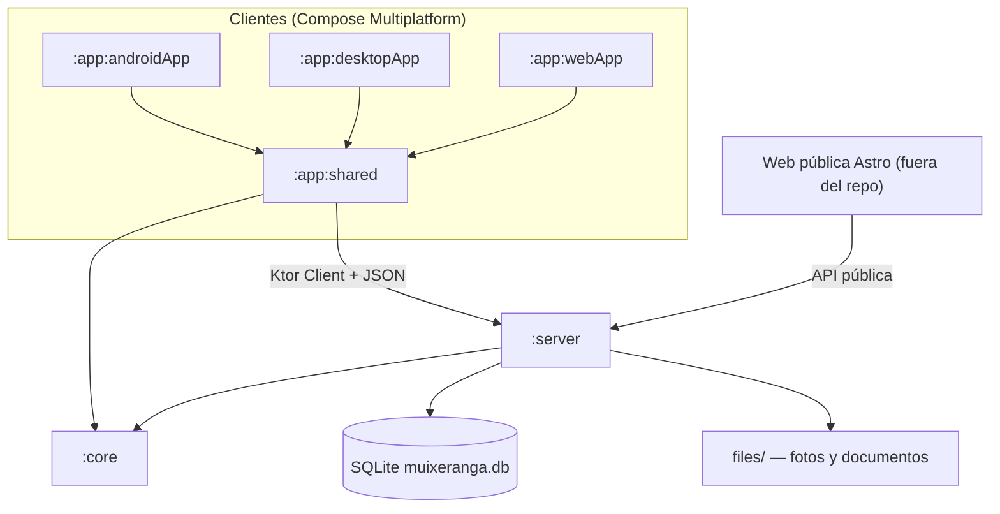

# Tabala — esquema de módulos

**Tabala** es el monorepo Kotlin Multiplatform de la Muixeranga d'Elx: modelos compartidos, API en el VPS y clientes Compose (Android, escritorio, web).

Lo que **no** vive en este repo (pero se conecta al backend):

- Web pública (Astro) → `api.<dominio>` (rutas públicas).
- Webapp de gestión (despliegue aparte) → misma API con token Firebase.

---

## Vista general



---

## Módulos Gradle

| Módulo | Tipo | Qué contiene | Despliegue |
|--------|------|--------------|------------|
| `:core` | KMP library | DTOs `@Serializable`, enums, validación | No se despliega solo; va dentro de server y apps |
| `:server` | JVM application | Ktor, SQLite, Flyway, auth Firebase, ficheros | Fat JAR al VPS (`api.<dominio>`) |
| `:app:shared` | KMP + Compose | UI, ViewModels, repos, Koin (`commonMain` + targets) | Empaquetado en cada cliente |
| `:app:androidApp` | Android app | `Application`, manifest, arranque Koin | APK/AAB |
| `:app:desktopApp` | JVM app | `main()` escritorio | Binario desktop |
| `:app:webApp` | JS/Wasm app | Entrada navegador | Static hosting |

---

## `:core`

- **Rol:** contrato de datos compartido entre backend y clientes.
- **Incluye:** modelos alineados con `backend/data-model/data-model.json` (IDs, fechas ISO 8601, `GeoPoint`, enums en inglés).
- **Excluye:** UI, Koin, Ktor, SQL, Firebase.
- **Source sets:** `commonMain` (+ targets Android/JVM/JS/Wasm para compilar en KMP).

---

## `:server`

- **Rol:** fuente de verdad de la colla (miembros, eventos, contratos, inventario, figuras, documentos, asistencia…).
- **Stack:** Ktor (JVM 21), SQLite, SQLDelight (consultas), Flyway (aplica migraciones al arrancar).
- **Esquema:** `server/src/main/sqldelight/migrations/V<n>__<name>.sqm` → genera `db/migration/*.sql` en el JAR.
- **Auth:** verifica ID tokens Firebase; guarda UID + rol; **no** guarda contraseñas.
- **Ficheros:** subidas bajo `files/` (configurable vía env en producción).
- **Variables típicas en VPS:** `DB_PATH`, `FILES_DIR`, `FIREBASE_PROJECT_ID`, `CORS_ORIGINS`.

---

## `:app:shared`

- **Rol:** casi toda la app de gestión.
- **Incluye:** Compose Multiplatform Material 3, MVVM (`StateFlow`), repositorios (Ktor Client), módulos Koin.
- **Plataforma:** lógica en `commonMain`; `androidMain`, `jvmMain`, `jsMain`, `wasmJsMain` solo para expect/actual (Firebase, drivers, etc.).
- **Depende de:** `:core` (tipos JSON), **no** de `:server` en Gradle (solo HTTP en runtime).

---

## Entradas de cliente (delgadas)

| Módulo | Responsabilidad |
|--------|-----------------|
| `:app:androidApp` | Iniciar Koin, tema, actividad única que monta UI compartida |
| `:app:desktopApp` | Ventana Compose + Koin |
| `:app:webApp` | Bundle JS/Wasm + recursos web |

Las pantallas nuevas van en `:app:shared`, no duplicadas por plataforma salvo necesidad real.

---

## Dependencias entre módulos

```text
:app:androidApp  ──► :app:shared ──► :core
:app:desktopApp  ──► :app:shared ──► :core
:app:webApp      ──► :app:shared ──► :core

:server          ──► :core
```

---

## Flujo de datos en runtime

1. El usuario inicia sesión con **Firebase** en el cliente.
2. El cliente envía peticiones a `https://api.<dominio>/…` con el ID token.
3. **`:server`** valida token y rol, aplica RGPD en rutas públicas, lee/escribe SQLite.
4. Las respuestas JSON se deserializan a tipos de **`:core`**.
5. **ViewModels** en `:app:shared` reducen estado → **Compose** pinta la UI.

---

## Carpetas de apoyo (no módulos)

| Ruta | Uso |
|------|-----|
| `specs/` | Especificaciones de producto antes de implementar |
| `docs/` | Documentación del repo (este fichero) |
| `AGENTS.md` | Guía para agentes/humanos (stack, convenciones) |
| `.cursor/rules/` | Reglas Cursor por área (shared, server, core) |

---

## Esquema de base de datos

Las tablas (19 en V1) reflejan el data model: `users`, `user_accounts`, `areas`, `events`, `contracts`, `figures`, `positions`, `position_types`, `groups`, `inventory_items`, `documents`, `attendance`, etc.

Detalle del SQL: `server/src/main/sqldelight/migrations/V1__initial_schema.sqm`.

Modelo conceptual y reglas de negocio: vault `backend/data-model/data-model.json` y `backend-stack.md`.

---

## Referencias

- [AGENTS.md](../AGENTS.md) — stack y convenciones de código
- Infra VPS: `infraestructura-servidor.md` (vault Muixeranga)
